<div align="center">

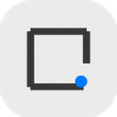

# Border Lab · 边框实验室

### 把照片装进留白，把拍摄信息留在画面里。

**八套模板 · EXIF 标注 · 批量导出 · 深浅主题**

[](https://github.com/tingzhouhuige/boarder-lab/releases/tag/v2.1.1)
[](https://github.com/tingzhouhuige/boarder-lab/releases/tag/v2.1.1)
[](LICENSE)
[](https://tingzhouhuige.github.io/boarder-lab/)

[下载 Windows 版](https://github.com/tingzhouhuige/boarder-lab/releases/tag/v2.1.1) · [在线打开](https://tingzhouhuige.github.io/boarder-lab/) · [本次更新](RELEASE_NOTES_v2.1.1.md)

</div>

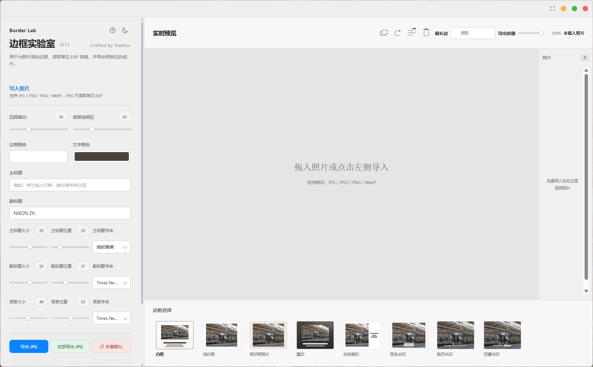

边框实验室是给摄影成片用的排版工具。把照片拖进来，选一套边框，调好文字与留白，再导出成片。Windows 桌面版和网页版共用同一套编辑逻辑，所有照片处理都在你本地完成，不上传、不联网。

---

## 这一版，把细节补齐了

### 调参更细，输入更准

连续型的参数现在支持 0.1 的步进，拖滑块能做更细微的调整；如果知道具体数值，也可以直接在滑块旁的数字框里输入。字号、位置、留白、纸纹强度都是这样，只有字重这类本身离散的参数才保留整档。

### 状态一眼能看懂

选中的照片是蓝色边框加勾选，上次导入的那一张用绿色标签标出来，不默认勾选；正在用的模板、正在开的开关都有明确的高亮。界面主体保持中性灰，只在需要提示的地方用一点蓝、绿、红。

### 第一次打开不懵

首次启动会有四步引导，依次指着导入、模板、参数、导出四个区域。看过一次就不再自动出现，左上角的问号随时能重新打开。

## 八套模板，各有各的用法

模板之间的差别不只是外框样式。有的把文字排在照片下方，有的把信息放到侧栏，有的干脆让纸张纹理盖住整张照片。

杂志侧栏把照片和相机、镜头、地点分开摆，左右各占一半，文字的字号、字体、位置都能单独调。

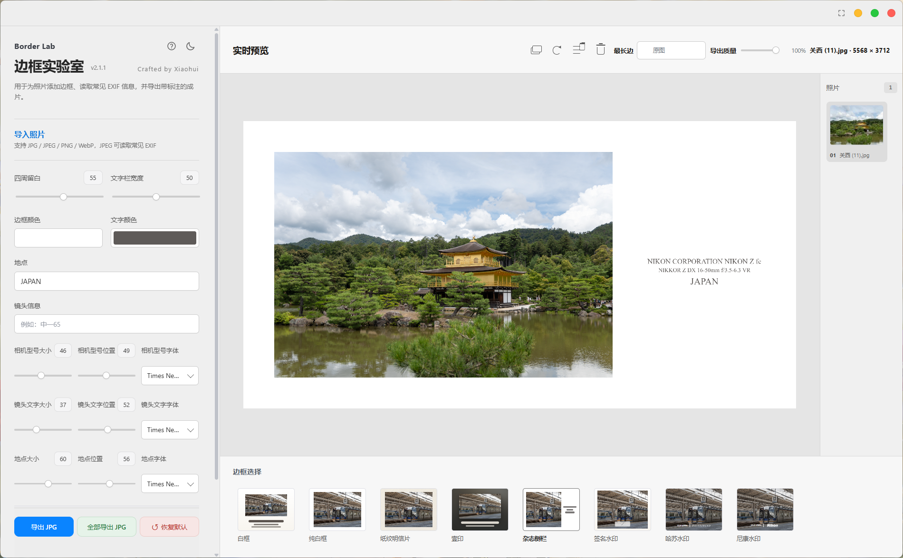

纸纹明信片会让照片和白边一起覆盖同一张纸的质感，强度可以调；壹印则从照片边缘延展出一层模糊背景，底部只留一行细字信息。

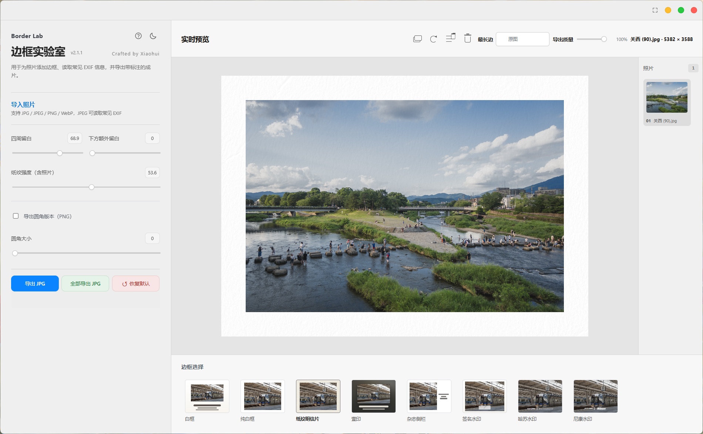

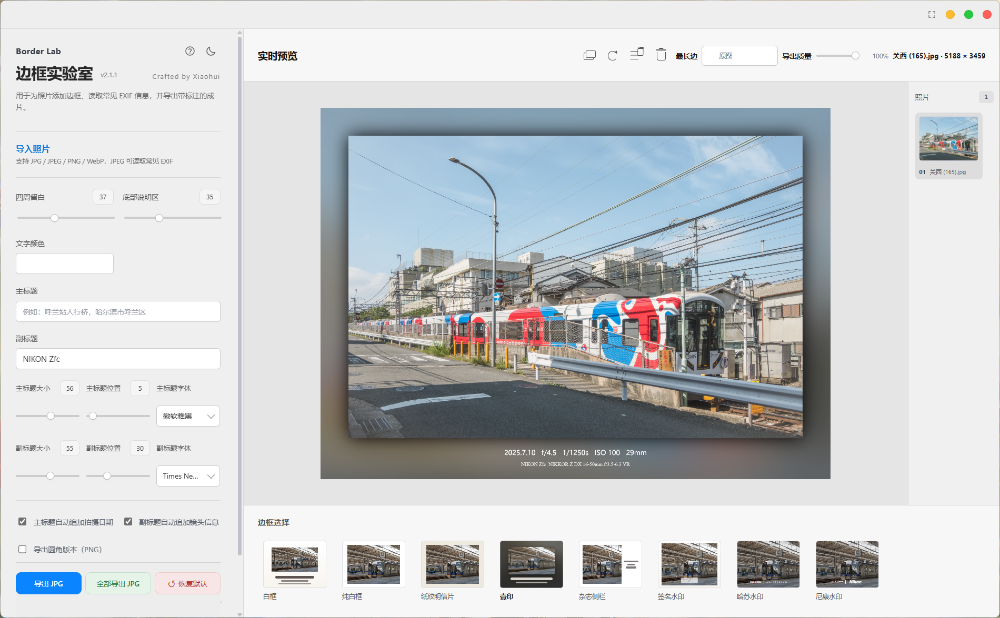

剩下的几套更贴近传统排版：**白框**是经典的照片说明版式，带标题、日期、镜头与 EXIF；**纯白框**只留白，可以给照片加一道细描边；**签名水印**让你导入自己的签名图片，位置、大小、透明度、反色都能调；**哈苏水印**和**尼康水印**用品牌标识配曝光三要素。

品牌风格模板只用于照片排版展示，相关商标归其权利人所有，本项目与这些品牌没有隶属或合作关系，详见 [NOTICE.md](NOTICE.md)。

## 从文件夹到成片

整个流程只有四步：导入照片、选模板、调参数、导出。首次引导会按这个顺序带你走一遍。

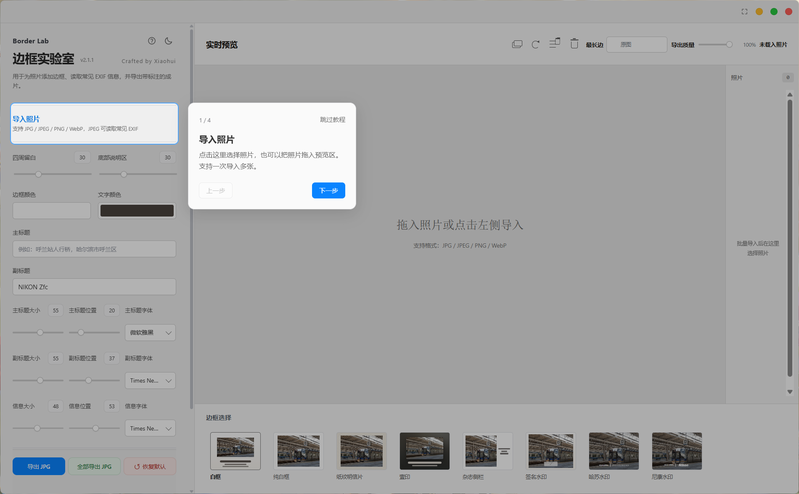

### 先选照片，再专心编辑

点「导入照片」会打开文件夹浏览器，它记得你上次停在哪，并用绿色标签标出上次导入的那张。大文件夹用虚拟列表，只渲染当前看得见的缩略图，滚动时暂停后台加载，停稳后再补齐。

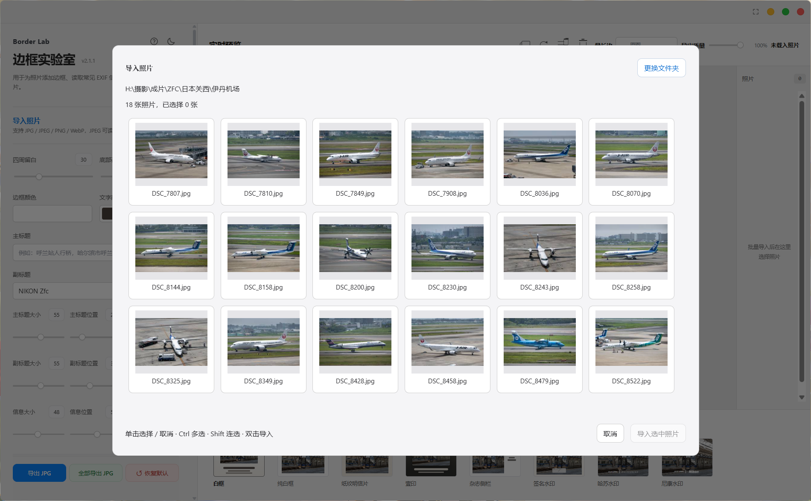

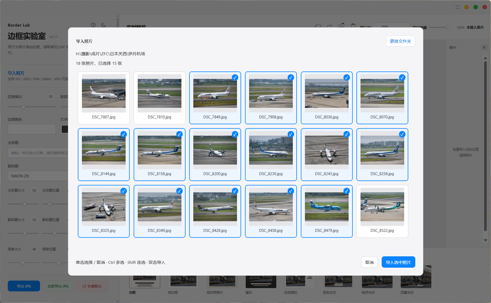

单击选中一张，再点一次取消这一张、其他保留；按住 Ctrl（macOS 上是 Cmd）可以逐张加选或减选，按住 Shift 连选一段；双击某张则直接导入它。编辑过程中 Ctrl+Z 撤销、Ctrl+Shift+Z 重做，当前会话最多记 100 步。预览里的标题、相机型号、EXIF 文字都能双击原位修改。

## 白天与夜晚，都让照片站在前面

主题会跟着你的选择记住。深色模式只改界面，不改成片配色——成片的颜色由模板和参数决定。

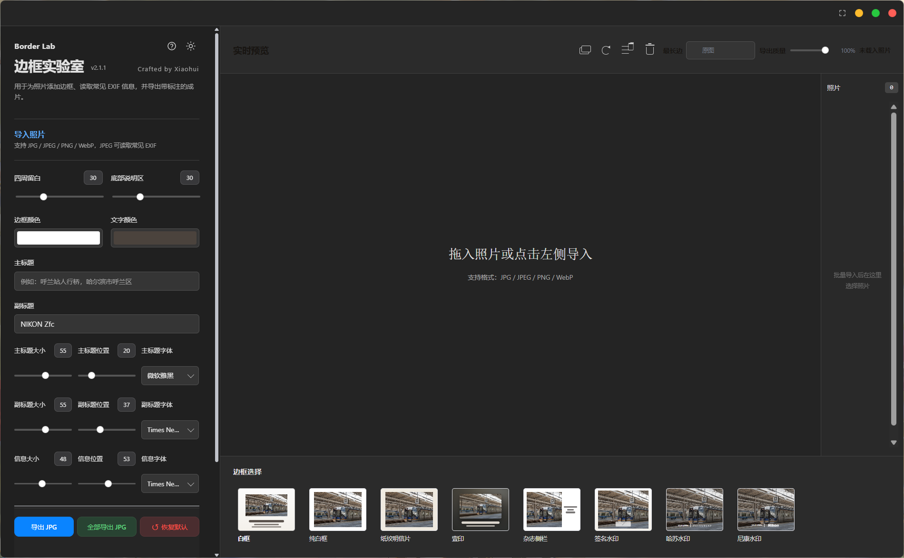

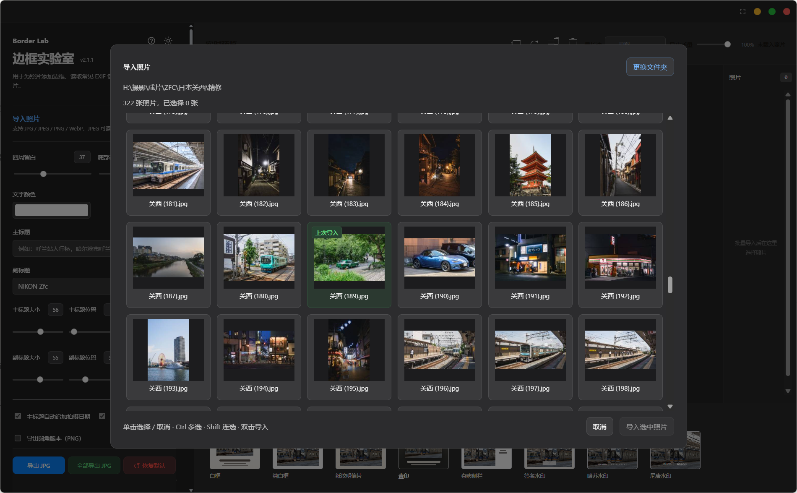

### 导出时，再决定尺寸

单张或批量导出 JPG 都可以，能设质量与最长边；需要圆角成片时导出 PNG。多张照片可以各自保留参数，也可以打开「同步全部照片」统一调整。

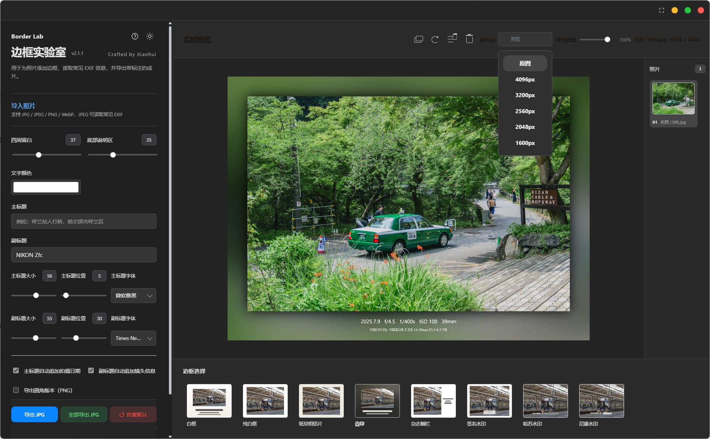

## 下载与安装

**Windows 桌面版**——下载 `Border-Lab-2.1.1-Windows-x64.exe` 双击即可，免安装；也可以取便携 ZIP，解压后运行同一个程序。首次启动会自解压，慢几秒是正常的。本版本未做代码签名，SmartScreen 提示时选择「仍要运行」。

**浏览器版**——直接打开 <https://tingzhouhuige.github.io/boarder-lab/>。想获得完整的文件夹浏览体验，建议用桌面版 Chrome 或 Edge；其他浏览器会回退到普通文件选择，编辑和撤销重做仍然可用。

**源码**——`Border-Lab-2.1.1-source.zip` 是完整仓库快照，不含依赖目录与缓存。构建方法见下方「开发与本地运行」。

支持导入 JPG、JPEG、PNG、WebP。常见 EXIF 主要面向 JPEG，读不到的信息可以手动补。网页版的文件夹访问依赖浏览器授权，重开页面时可能需要重新选择文件夹；清理站点数据会一并清掉主题、引导记录和缩略图缓存。

## 许可与免责

本项目以 **GNU GPL v3.0** 发布，完整条款见 [LICENSE](LICENSE)。你可以使用、研究、修改和再分发，但再分发时需要保留同样的许可与源码可得性。

使用前请读一下 [DISCLAIMER.md](DISCLAIMER.md)：软件按现状提供，照片和内容的使用责任由你承担，导出前建议保留原始照片备份。

第三方素材与商标的说明集中在 [NOTICE.md](NOTICE.md)：壹印是独立的 GPL-3.0 开源项目，本项目的同名模板只是版式风格的独立实现，没有使用其代码或素材；哈苏、尼康标识归各自权利人，本项目与它们没有隶属关系。

<details>
<summary><b>开发与本地运行</b></summary>

```bash
npm ci
npm start
```

`app.js` 等模块是维护入口，`border-lab.js` 是由它们生成的网页脚本；改完运行 `npm run build:web`，不要只改生成文件。首次引导在 `onboarding.js`。打包 Windows 便携版用 `npm run dist`。

网页版需要本地静态 HTTP 服务打开 `index.html`——文件夹授权、Worker 与存储都要求 localhost 或 HTTPS。

</details>

<details>
<summary><b>文档与历史版本</b></summary>

- [v2.1.1 更新说明](RELEASE_NOTES_v2.1.1.md)
- [历史更新记录](docs/releases/README.md)
- [发布与构建指南](docs/releasing.md)
- [纸纹资源说明](docs/paper-textures.md)
- [所有正式版本](https://github.com/tingzhouhuige/boarder-lab/releases)

</details>

---

<div align="center">

**Border Lab · Crafted by Xiaohui**

让照片是主角，让工具安静一点。

</div>
